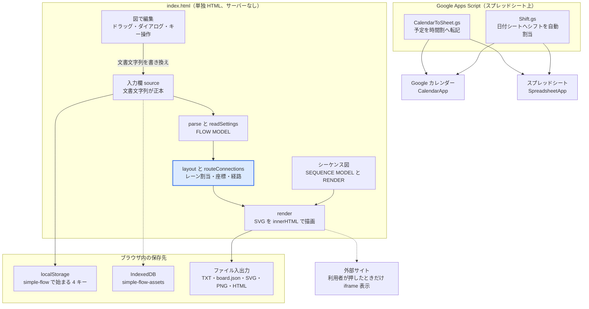
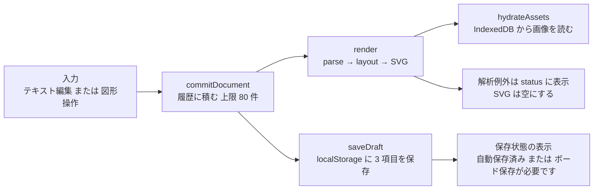
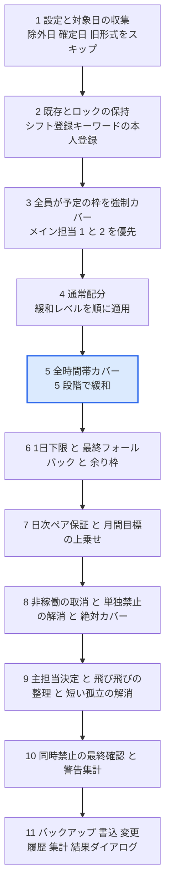

# 核心設計と安全性設計

この資料は、`tool` の核心設計（アーキテクチャと主要な設計判断）と安全性設計、および実装上の判定条件・閾値・正規表現を、正規ソース `index.html`・`CalendarToSheet.gs`・`Shift.gs` の実装から抜き出してまとめたものです。利用者向けの説明は [README.md](../README.md) を正本とし、本資料は実装側の判定条件を補います。

- 対象: main（コミット `878a7c0` 時点）
- 更新日: 2026-10-22

## 1. 概要と読み方

このリポジトリには、互いに依存しない 3 本のツールが置かれている。

1. `index.html`（2,408 行）: 「かんたん業務フロー作成」。「図で編集」とテキスト記法の両方で、担当者・部署ごとのスイムレーン型業務フロー図とシーケンス図を作る単独 HTML ツール。ビルドも外部 CDN も持たず、ブラウザで開くだけで動く。
2. `CalendarToSheet.gs`（730 行）: Google Apps Script。Google カレンダーの予定を時間割形式でスプレッドシートへ転記する。
3. `Shift.gs`（6,667 行）: Google Apps Script。複数メンバーのカレンダー予定を読み、日付シートへ 15 分スロット単位でシフトを自動割り当てする大規模スクリプト。

本資料は `index.html` の判定条件を最も詳しく、`CalendarToSheet.gs` を全体、`Shift.gs` を設定・可用性判定・割当パイプラインの核心に絞って扱う。`Shift.gs` で読み切れなかった領域は「9. 既知の制約と資料との食い違い」に明記する。README には `index.html` に加えて `CalendarToSheet.gs`、`Shift.gs` の用途・設定・メニューと、2 本を同じプロジェクトに入れるときの注意（`onOpen` の衝突、日付名シートの衝突）を載せている。

| 知りたいこと | 正本（リポジトリ内） |
| --- | --- |
| `index.html` の使い方・制限値（利用者向け） | `README.md` |
| テキスト記法の解析・自動配置・保存形式 | `index.html` の `// BEGIN FLOW MODEL` 〜 `// END FLOW MODEL`（`parse`、`layout`、`routeConnections`、`readSettings`） |
| シーケンス図のデータ検証・取り込み | `index.html` の `// BEGIN SEQUENCE MODEL` 〜 `// END SEQUENCE MODEL`、描画は `// BEGIN SEQUENCE RENDER` 〜 `// END SEQUENCE RENDER` |
| 画面操作・保存・出力 | `index.html` の `render`、`commitDocument`、`saveDraft`、`importBoardFile`、`exportSvg` |
| 回帰テスト | `tests/flow-model.test.cjs`、`tests/sequence-model.test.cjs`、`tests/sequence-render.test.cjs` |
| カレンダー転記の仕様 | `CalendarToSheet.gs`（先頭コメントと `extractCalendarToSheet`） |
| シフト自動割当の仕様 | `Shift.gs`（`autoAssignShifts`、`computeAvailabilityMatrix`、`getOperationConfig_`） |
| エージェント運用 | `CLAUDE.md`、`AGENTS.md`、`docs/agent-orchestration.md` |

## 2. 全体アーキテクチャ

`index.html` は 1 つの HTML に CSS と単一の `<script>` を内包し、状態の正本を「入力欄の文書文字列」に置く。図形の座標・色・画像カード・シーケンス図データは、その文書の `# @flow ` 行（JSON）に畳み込まれるため、取り消し履歴・自動保存・TXT 保存がすべて同じ文字列を対象にする。2 本の `.gs` は同一スプレッドシートに追加して使うコンテナバインド型で、メニューから手動実行する。



上段が `index.html` の内部（操作から文書文字列、解析、配置、描画の順）、中段がブラウザ内の保存先、下段が Google サービスへ出る 2 本の `.gs` である。`index.html` から外部へ出る通信は、利用者が「埋め込みを表示」を押したときの iframe だけで、`fetch` や CDN 読込は存在しない（`Grep` で `fetch(`、`XMLHttpRequest`、`sendBeacon`、外部 `<script src>` が無いことを確認済み）。

| 設計判断 | 内容 | 根拠となる実装 |
| --- | --- | --- |
| 文書文字列を唯一の正本にする | 図形の追加・移動・色・接続表示・画像カード・シーケンスデータはすべて `# @flow ` 行の JSON か本文行に書き戻す。履歴は文字列のスタックで持つ | `commitDocument`、`readSettings`、`writeSettings` |
| 純粋ロジックを DOM から分離する | `BEGIN/END` マーカー間は DOM API を使わず、テストが `vm` で取り出して評価する | `tests/*.test.cjs`、`index.html` の各マーカー |
| 差分だけを書き換える編集 | 線の文字・図形挿入・名前変更は元の文字オフセット（`tokens`、`occurrences`）だけを置換し、コメント・改行コード・他の行を保つ | `parse`、`replaceRanges`、`editEdgeLabel`、`insertEdgeNode`、`applyDiagramText` |
| 自動配置と手動配置の併存 | 階層（level）とレーン内スロットで自動配置し、ドラッグで保存した座標があるノードだけ上書きする。向きごとに別保存 | `layout`、`moveVisualNode`、`resetPositions` |
| データはブラウザ内で完結 | 画像は IndexedDB、本文は localStorage。持ち運びは `.board.json`。画像を外部へ送らない | `storageSet`、`openAssetDatabase`、`saveBoardBtn` |
| 取り込みでコードを実行しない | シーケンス HTML の取り込みは専用の小さなリテラル解析器で、式・関数呼び出しを拒否する | `seqParseDataLiteral`、`importSequenceHtml` |
| 2 本の `.gs` は独立 | 定数は `CTS_` 接頭辞で分け、`isAllDayEventSafe` 系の補助関数は `cts_isAllDayEventSafe_`、`shift_isAllDayEventSafe_` とファイル別の名前にしてある。名前が重なるのは Apps Script のトリガー名である `onOpen` だけで、別々のプロジェクトで使うか、`onOpen` を 1 つに統合して使う（README） | `CalendarToSheet.gs`、`Shift.gs` |
| シフトは「本人の列」だけに入る | 日付シートはユーザー数 N に対し、予定列 N とシフト列 N（先頭シフト列は N+2 列目）。各シフト列は 1 人専用 | `setupLayout`、`fillUserShift`、`canAssign` |

## 3. 主要モジュールと責務

### 3.1 index.html

| 範囲（行番号は目安） | 責務 | 主な関数・定数 |
| --- | --- | --- |
| 8〜180 | CSS | `:root`、`.app`、`.edge-dialog` ほか |
| 182〜341 | 画面の骨格とダイアログ 4 種 | `#source`、`#diagram`、`#edgeDialog`、`#textDialog`、`#embedDialog`、`#seqPeopleDialog` |
| 344〜385 | アイコン定義、サンプル文、配色テーマ、状態変数 | `icons`、`examples`、`themes` |
| 386〜444 | 永続化・履歴・入力補助 | `storageGet`、`storageSet`、`saveDraft`、`commitDocument`、`restoreHistory`、`insertPart` |
| 445〜447 | エスケープと文字の折り返し | `escapeHtml`、`escapeAttr`、`svgText` |
| 449〜1099 | シーケンス図のデータモデル | `normalizeSequence`、`seqValidateStrictSequence`、`seqParseDataLiteral`、`importSequenceHtml`、`seedSequence` |
| 1100〜1135 | メディアカードと持ち運びボードの検証 | `safeMediaUrl`、`normalizeMedia`、`resizeMedia`、`validateBoard` |
| 1136〜1423 | フロー図のモデル（解析・編集・配置・経路） | `parseSettingsLine`、`invalidSettingsLines`、`settingsWarning`、`readSettings`、`writeSettings`、`readNode`、`flowParts`、`parse`、`removeFromFlow`、`layout`、`shouldShorten`、`routeConnections` |
| 1429〜2020 | シーケンス図の SVG 描画（DOM 非依存） | `renderSequenceDiagram`、`seqWrap`、`seqEscape`、`seqTheme` |
| 2021〜2204 | 描画本体と編集ダイアログ、ドラッグ、キー操作 | `syncSettingsWarning`、`render`、`activateDiagram`、`applyDiagramText`、`finishDrag` |
| 2205〜2226 | 出力 | `exportSvg`、`downloadBtn`、`pngBtn` |
| 2227〜2342 | 画像・リンクカード、ボード保存と読込 | `openAssetDatabase`、`prepareImage`、`addImages`、`addEmbed`、`renderMediaCards`、`importBoardFile` |
| 2344〜2406 | シーケンス編集 UI と共有 HTML | `sequenceReference`、`switchDiagram`、`buildShareHtml` |

### 3.2 CalendarToSheet.gs

| 関数 | 責務 |
| --- | --- |
| `onOpen` | メニュー「カレンダー取得」を作る（① 設定シートを作成、② 予定を取得して反映） |
| `createCalendarConfigSheet` | 設定シート `カレンダー設定` を作成。既存があれば確認ダイアログ後に初期化 |
| `readCalendarConfig_` / `readCalendarUsers_` | 設定の読み取りと検証、取得対象ユーザーの読み取り |
| `extractCalendarToSheet` | 本体。日 × ユーザーで予定を取得し、シートへ出力 |
| `fetchEvents_` / `buildSlotData_` | 1 日分の予定取得（`{events, error}` を返し、失敗を `error` で区別する）、時間スロットへの割り付け |
| `recordFetchError_` / `formatFetchErrors_` | 取得失敗をメール単位で集計し、完了ダイアログ・ログ用の文章にする |
| `timeOrDefault_` / `stepOrDefault_` / `cts_safeCellText_` | 不正な時刻・刻みを既定値にして理由を残す、題名の先頭が `= + - @` なら先頭にアポストロフィを付ける |
| `writeVertical_` / `writeHorizontal_` / `mergeAndColorRuns_` / `clearOutputArea_` | 出力レイアウトと前回出力の消去 |

### 3.3 Shift.gs

| 領域（行番号は目安） | 責務 | 主な関数 |
| --- | --- | --- |
| 1〜125 | 定数（セル位置、列番号、既定値） | `BREAK_HOURS`、`LUNCH_START`、`MAX_PEOPLE_PER_DAY`、`LOCK_ROW`、`TIME_SLOT_START_ROW` |
| 127〜283 | メニューと期間指定の再割当 | `onOpen`、`autoAssignShiftsRange`、`parseInputDate_` |
| 286〜553 | シフト欄の初期化、カレンダー反映、集計 | `initializeShiftCellsOnly`、`updateTeamCalendarSheets`、`updateSettingsTotalsOnly` |
| 554〜936 | 空き時間の抽出（4 区分） | `extractFreeTimeCore_`、`FREE_TIME_TYPES` |
| 945〜3148 | 自動割当の本体（約 2,200 行のパイプライン） | `autoAssignShifts` |
| 3150〜3524 | 可用性・主担当・キーワード・1 人分の割当 | `computeAvailabilityMatrix`、`computeSpecialBlockMatrix`、`selectDailyMainLeadIdx`、`fillUserShift`、`canAssign` |
| 3526〜4283 | 確定フラグ、除外日、集計、日付シートの描画 | `isDayConfirmed_`、`writeAssignmentsToSheet`、`autoPopulateExcludedDates`、`updateSettingsTotals`、`saveShiftData`、`restoreShiftData`、`setupLayout`、`fillAllEvents` |
| 4285〜4601 | 手動編集の色付け、ユーザー読み込み、時刻・時間数の解析、予定の取得 | `onEdit`、`readUsers`、`timeCellToMinutes_`、`parseTimeCell`、`parseHoursValue`、`fetchEvents`、`recordFetchError_` |
| 5226〜5438 | 運用設定シートと割当モード | `getOperationConfig_`、`buildStrictnessLevels_` |
| 5443〜5714 | キーワードルール、ユーザー属性（同時禁止・単独禁止） | `readKeywordRules_`、`readUserAttributes_`、`getForbiddenPartnersMap_` |
| 5715〜6132 | 変更履歴、バックアップ、不足日レポート、補填、設定チェック | `appendAutoAssignChangeLog_`、`createShiftBackupNow_`、`buildShortageRows_`、`fillShortageOnlySafely`、`validateSettings` |
| 6370〜6667 | 週次担当（週ごとの主担当・稼働メンバー） | `readWeeklyAssignments_`、`applyWeeklyConfigToDay_`、`createWeeklyAssignmentSheet` |

## 4. 主要な処理の流れ

### 4.1 index.html: 入力から描画・保存まで



- 図形操作（ドラッグ、色、担当、接続、削除など）は、`updateNode`、`moveVisualNode`、`connectNodes`、`removeFromFlow` などが新しい文書文字列を返し、`commitDocument(next, options)` に渡す。
- 同じ文字列なら何もしない。入力欄のキー入力（`event.isTrusted`）は、直前も入力かつ 700 ms 未満なら履歴を 1 件にまとめる。
- `render` は `parse` → `layout` → SVG 文字列の生成 → `svg.innerHTML`。例外はキャッチして `#status` にメッセージを表示し、図を空にする（`lastGraph=null`）。
- 画像は文書には `assetId` だけを持たせ、本体は IndexedDB から `hydrateAssets` が非同期に読む。

### 4.2 Shift.gs: 自動割当（autoAssignShifts）の段階



- 段階の順序は `autoAssignShifts` のコメント見出し（`// ===== ... =====`）の出現順である。各段階の条件は 5.10 の表に示す。
- 書き込みの直前に `createShiftBackupNow_` が非表示シート `__シフトバックアップ` へ全日付シートのシフト欄を保存し、`appendAutoAssignChangeLog_` が差分を `変更履歴` シートへ追記する。`dryRun` オプション時は書込の前に結果を返して終了する。

## 5. 判定条件の詳細

### 5.1 index.html: テキスト記法の解析

`parse(text)` は文書を `\n` で分割し、1 行ずつ処理する。行の判定は上から順に次のとおり。

| 条件 | 実装 | 結果 |
| --- | --- | --- |
| 空行、または先頭が `#` | `parse` | 無視する（`# @flow ` 設定行もここで読み飛ばされ、設定は `readSettings` が別に読む） |
| 末尾が全角または半角コロンで、行に矢印記号 `→` `>` `-` を含まない（引用符始まりなら含んでもよい）（(A) を参照） | `parse` のレーン見出し判定 | 現在のレーンを切り替える。名前が空なら `共通`。`lanes` に重複なく追加し、`laneTokens` に範囲を記録 |
| 上記以外 | `flowParts` で分割 | 各パーツを `readNode` でノードにし、隣接パーツ間に辺を張る |
| レーン見出しが 1 つも無い | `hasHeader` が偽のまま | `implicitLane` を真にし、全ノードのレーンは `共通` |
| 同じ ID のノードが再登場 | `addNode` | 明示記法（括弧つき）の側が優先して上書き。レーンは最初の定義を保持 |
| 同じ（from, to, label）の辺が再登場 | `edgeMap` のキーは `JSON.stringify([from, to, label])` | 辺を増やさず `occurrences` に追加。ラベルが違えば別の辺 |
| `flowParts` で引用符内・括弧内にある矢印やコロン | `quote`、`stack` の状態管理 | 通常の文字として扱う（括弧は `(` `[` `{` の入れ子を追跡し、対応する閉じ括弧で戻る） |
| 矢印の種類 | `flowParts` | `-->`（3 文字）、`->`（2 文字）、`→`（1 文字）の順に判定 |
| ラベル記法 | `flowParts` | 矢印の前の `--` 以降がラベル（`decodeText` で、引用符始まりなら JSON 文字列として復号） |
| ノードの種類 | `readNode` | (B) の順に判定。括弧なしの語は (C) で推定、いずれにも当たらなければ処理 |
| `# @flow ` 設定の適用 | `parse` の末尾 | `settings.nodes` の `lane`、`color` を該当ノードに上書き。未知のレーン名は `lanes` に追加 |

```text
(A) レーン見出し行（parse）
/^(.+?)[：:]$/
かつ  !/[→>-]/.test(line)  または  laneHeader[1].startsWith('"')

(B) 明示ノード記法（readNode。上から順に判定）
終了・開始: /^(.+?)\(\((.+)\)\)$/    → type terminal、ID と表示名を分離
判断:       /^(.+?)\{(.+)\}$/        → type decision
処理:       /^(.+?)\[(.+)\]$/        → type process（既定）

(C) 括弧なしの語の種類推定（readNode。後の判定が前を上書きする）
/開始|受付$/   → terminal
/完了|終了$/   → terminal
/[?？]$/       → decision

(D) 挿入ボタンの補助判定（insertPart）
行がレーン見出しか: /^[^→\n]+[：:]\s*$/
直前が矢印で終わるか: /(?:→|->|-->)$/
直後が矢印で始まるか: /^(?:→|->|-->)/
```

画面から追加した名前は `JSON.stringify` した引用符付きで保存される（`nodeDefinition`、`editNodeText`、`editLaneText`）。引用符付きの名前は `decodeText` が `JSON.parse` で復号し、失敗すると生の文字列を使う。

### 5.2 index.html: 自動配置アルゴリズム（layout）

| 関心事 | 実装されている条件 |
| --- | --- |
| 階層（level）の決め方 | 入次数 0 のノードを起点に、辺をたどって `levels[to] = max(既存, levels[from]+1)`。入次数が 0 になった順にキューへ積む（トポロジカル順） |
| 循環・自己ループ | キューで処理されなかったノードは、未確定のまま幅優先で `level+1` を付与。無限ループにならない（テスト `cycles and self-loops remain finite`） |
| ノードの大きさ | 幅: 判断 160、それ以外 166。高さ: 判断は `max(90, ceil(文字数/9)*28+30)`、それ以外は `max(62, ceil(文字数/12)*16+24)`。文字数は `[...label]`（コードポイント数） |
| 流れ方向の間隔 `flowStep` | 横: `max(320, nodeWidth+labelWidth+110, nodeWidth+60+gapFan*24)`。縦: `max(240, nodeHeight+jumpFan*(labelHeight+46)+45, nodeHeight+60+gapFan*24)` |
| 流れ方向の原点 `flowOrigin` | 横: `260+gapFan*12`。縦: `max(140, 94+nodeHeight/2)+gapFan*12` |
| 交差方向のセル `crossCell` | 横: `max(nodeHeight+60, 60+fan*(labelHeight+44), nodeHeight+60+2*jumpFan*(labelHeight+46))`。縦: `max(240, nodeWidth+40+fan*16, fan*(labelWidth+36)+60, jumpFan ? nodeWidth+2*(labelWidth+60) : 0)` |
| 同じレーン・同じ level の衝突回避 | キー `JSON.stringify([lane, level])` ごとに `slot` を 0,1,2… と採番し、`cross = crossStart + crossCell*(slot+0.5)` |
| レーンの帯 | レーンごとに `contentCross = max(最大slot数*crossCell, 手動配置ノードの下端+30)`、`size = contentCross + 60 + 迂回辺数*16`。`gutter = start + contentCross + 24`（迂回路の通り道） |
| 手動配置 | 保存座標があるノードは `x = max(170, flow)`（横）または `y = max(90, flow)`（縦）、交差方向は `帯の start + cross`。`manual = true` |
| 保存座標の範囲 | `readSettings` が `flow`、`cross` を 20〜12000 に丸める。有限数でない座標は捨てる |
| ドラッグ時の座標 | `moveVisualNode`: 中心が入る帯でレーンを再判定し（外れたら最後の帯）、`flow >= 90`（縦）または `170`（横）、`cross >= 20`。既定でグリッド 10 px にスナップ、Shift 押下でスナップなし |
| キー移動 | 矢印キーで 10 px、Shift 付きで 1 px（スナップなし） |
| 図全体の大きさ | 最小幅 横 760 / 縦 400、最小高さ 360。ノード・経路・メディアカード・バッジの端 + 余白（40〜80）の最大値まで広げる |
| 表示倍率 | `fitDiagram`: `min(1, 幅比, 高さ比)`。手動ズームは 0.1〜2 に丸め、ボタンで ±0.1 |

### 5.3 index.html: 線の経路・遠い接続

| 条件 | 実装 | 結果 |
| --- | --- | --- |
| 「番号で省略」にする辺 | `shouldShorten`: 辺の個別設定が `jump`、または（個別設定が `default` かつ全体設定 `longLinks` が `auto` かつ「遠い」） | `③へ` 形式のバッジ辺にする |
| 「遠い」の定義 | `delta >= 3`（3 段階以上先）、`delta <= 0`（同段・戻り）、またはレーン番号の差が 2 以上 | 上記の条件に使う |
| バッジの文字 | `referenceNumber(number)`: 20 以下は丸数字（U+2460 起点）、21 以上は `(21)` | ノード番号は `graph.nodes` の出現順 |
| 経路の分岐 1 | ジャンプ辺 | 出口から 14 px 右へ出し、`a` の右下 30 px にバッジを置く |
| 経路の分岐 2 | どちらかのノードが手動配置 | 距離 55 px 超ならコの字 3 区間（中点は `oi-ii` に 10 px を掛けてずらす）。以下なら外側を回る 6 点の経路（余白 35 + `index*10`） |
| 経路の分岐 3 | `delta === 1`（隣の段） | 同じ段間の辺同士を 12 px ずつずらす。同じ 2 ノード間に複数辺があれば並走トラックに分ける |
| 経路の分岐 4 | それ以外 | レーン帯の `gutter` を通る迂回路（出入りは 24 px 離し、辺ごとに 12 px/16 px ずつずらす） |
| 出入口の位置 | `port`: 辺の本数に応じ、交差方向の幅 `min(半幅, 40)` の範囲に等間隔で並べる | 判断（ひし形）は縁の傾きに合わせて流れ方向の位置を補正 |
| 色と線種 | 6 色のパレットを辺の連番で巡回し、6 本ごとに破線パターン `''`、`7 4`、`2 4` を切り替え | モノクロ配色では全辺 `#596374` で、4 種の破線を巡回 |
| ラベル | 12 文字で折り返し。幅 `max(36, 最長行*12+18)`、高さ `行数*15+10` | 既定は最長区間、迂回路や並走路は 3 番目の区間の中点に、白地の枠で表示 |

### 5.4 index.html: 編集操作と取り消し

| 条件 | 実装 | 結果 |
| --- | --- | --- |
| 履歴の上限 | `commitDocument`: スタックが 80 を超えたら先頭を捨てる | 戻す・やり直しは最大 80 操作。再読み込みで消える |
| 履歴の対象 | 本文、選択ノード、選択メディア、フロー名、配色 | 配色変更は `saveDraft` のみ（履歴には積まない） |
| 連続入力のまとめ | `options.typing` かつ直前も入力かつ 700 ms 未満 | 履歴に積まない |
| 図形名の更新 | `updateNode`: 空は `図形の名前を入力してください`。存在しないレーンは `担当レーンを選択してください` | ダイアログ内に赤字で表示 |
| 担当名の更新 | `editLaneText`: 空は不可。別レーンと同名は `同じ名前の担当レーンがあります。別の名前にしてください`。暗黙レーン `共通` は見出し行を補う | 設定内のレーン名参照も更新 |
| 接続 | `connectNodes`: 同一ノードは `別の図形を選んでください`。同じ（from, to, label）の辺が既にあれば何もしない | 「すでに接続されています」と通知 |
| ノード削除 | `removeFromFlow`: 該当 ID を行から取り除き、前後は自動でつなぎ直さない。設定の座標・接続設定も削除 | 確認ダイアログは出さず、トーストで「戻す」を案内 |
| 辺の削除 | `removeFromFlow` の `removeEdge`: 一致する区間だけ切り、他のラベル・辺は保持 | 同上 |
| 線の途中への挿入 | `insertEdgeNode`: ID は `工程`、`判断`、`開始終了` + 空き番号。既存辺の全出現を置換し、ラベルは手前の辺に残す | 個別接続設定（`jump` など）は始点を新ノードへ付け替え、ラベルを空にする |
| 編集中に本文が変わった | `applyDiagramText`: ダイアログを開いた時点の本文と異なれば適用しない | 「入力内容が変わりました。閉じて選び直してください。」 |
| 差分適用 | 先頭・末尾の共通部分を除いた差分だけを `insertText` で入れる | 入力欄のネイティブ取り消しも使える |
| ショートカット | Ctrl/Cmd+Z、Ctrl/Cmd+Shift+Z または Y、Ctrl/Cmd+D、Delete と Backspace、矢印 | 入力欄・ダイアログ操作中は無効（本文入力欄 `source` は Ctrl+Z 系のみ有効） |
| 新規作成 | `resetBtn` | `confirm('入力内容を消して新しく作成しますか？')` の後、本文を `開始 → ` にする |
| 入力欄の最大文字数 | HTML の `maxlength` | 図形名 120、担当名 40、線の文字 80、挿入図形の文字 80、メディアのタイトル 100、シーケンスの内容 1200 |

### 5.5 index.html: 保存形式と永続化

`# @flow ` で始まる行（最後に有効な 1 行）の JSON を `readSettings` が読み、`writeSettings` が本文の先頭に 1 行で書く（元の改行コードを維持）。

| キー | 検証・既定値 |
| --- | --- |
| `diagramType` | `sequence` 以外は `flow` |
| `orientation` | `vertical` 以外は `horizontal` |
| `longLinks` | `auto` 以外は `line` |
| `sequence` | `normalizeSequence` で正規化（5.7） |
| `media` | `normalizeMedia`（5.6） |
| `connections` | 要素が `from`、`to`、`label`（文字列）と `mode`（`line` または `jump`）を持つものだけ残す |
| `nodes[].color` | `blue`、`green`、`orange`、`purple`、`pink` 以外は `auto` |
| `nodes[].positions` | `horizontal`、`vertical` ごとに `flow`、`cross` が有限数のときだけ採用 |
| JSON が壊れている | `parseSettingsLine` が、JSON として読めない行、またはオブジェクトでない行を「壊れた設定行」と判定する。`readSettings` はその行を無かった扱いにして設定を既定値で読むが、`render` が `settingsWarning`（行番号つきの文言）を画面上部の警告帯 `#settingsWarning` とコンソールに出す。`writeSettings` は読み取れた設定行だけを新しい 1 行に置き換え、壊れた行は削除せず本文に残す（保存し直しても元のデータは失われない） |

| 保存先 | キー・名前 | 内容と失敗時の扱い |
| --- | --- | --- |
| localStorage | `simple-flow-source` | 本文。`saveDraft` が毎回書く |
| localStorage | `simple-flow-name` | フロー名 |
| localStorage | `simple-flow-theme` | 配色。読込時は `blue`、`green`、`mono` 以外なら `blue` |
| localStorage | `simple-flow-editor-mode` | `visual` または `text`（`setEditMode` が書く） |
| IndexedDB | データベース `simple-flow-assets` バージョン 1、ストア `assets`（`keyPath: id`） | 画像 1 件が `{id, dataUrl, width, height}` |
| 読み書き失敗 | `storageGet` は既定値を返す。`storageSet` は `false` を返す | 保存失敗やアセット欠落があると、ヘッダーの状態が `ボード保存が必要です`（`error` 表示）になる。IndexedDB 書込失敗は `unsavedAssets` に記録 |
| 保存状態の文言 | `saveDraft` | 未読込の画像があれば `画像を読み込み中`、全部成功なら `自動保存済み`、それ以外は `ボード保存が必要です` |
| TXT 保存 | `saveTextBtn` | 本文を `text/plain;charset=utf-8` で `<フロー名>.txt`。画像データは含まない |
| ボード保存 | `saveBoardBtn` | `{format:'simple-flow-board', version:1, name, theme, source, assets}` を `<フロー名>.board.json`。画像が 1 つでも見つからなければ保存しない（`画像が見つかりません。元のボードファイルを読み込んでください`） |

### 5.6 index.html: 画像・リンクカード・ボード読込

| 条件 | 実装 | 結果 |
| --- | --- | --- |
| カード数の上限 | `normalizeMedia` が先頭 100 件に切る。`addMediaCards` と `addImages` が追加前に 100 超を拒否 | `カードは1つのボードに100枚まで追加できます`、画像追加時は `カードは100枚まで追加できます` |
| カード ID の検証 | (E) の ID 形式と重複排除 | 不正・重複は捨てる |
| 種類 | `image` または `embed` | それ以外は捨てる |
| 埋め込み URL | `safeMediaUrl`: 文字列、4096 文字以下、`new URL` で解釈でき、`http:` または `https:`、ユーザー名・パスワードなし | 満たさなければ `null`。`javascript:`、`data:`、`file:`、`//example.com` はテストで拒否を確認 |
| 画像カードの `assetId` | (E) の形式 | 不正なら捨てる |
| 位置とサイズ | `normalizeMedia`: x、y は 12〜12000（既定 200、100）、幅 120〜2000（既定 360）、高さ 90〜1800（既定 260）、`aspect` は `false` 以外すべて真、枠色は `gray`、`blue`、`green`、`purple`（既定 `gray`） | 範囲外は丸める。非数は既定値 |
| タイトル | 100 文字で切る。未指定は画像なら `画像`、リンクなら `リンク` | |
| サイズ変更（比率保持） | `resizeMedia`: 内側の画像領域は幅 −24、高さ −52。幅 2000、高さ 1800 の上限に収めて比率を維持 | 幅と高さは四捨五入 |
| 受け付ける画像 | `prepareImage`: MIME が `png`、`jpeg`、`webp`、`gif`、`bmp` | それ以外は `PNG・JPEG・WebP・GIF・BMPの画像を選んでください` |
| 1 枚の上限 | `file.size > 20000000` | `画像は1枚20MBまでです` |
| 画素数の上限 | `naturalWidth * naturalHeight > 60000000`、または 0 | `画像のサイズが大きすぎます` |
| 縮小 | 長辺を 2000 px 以内に縮小（`scale = min(1, 2000/長辺)`） | JPEG は品質 0.9 の JPEG、それ以外（GIF 含む）は PNG の静止画として保存 |
| 初期カードサイズ | 幅 `max(180, min(440, 画像幅+24))`、高さ 260 から比率で再計算 | 追加ごとに 28 px ずつ位置をずらす |
| 貼り付け・ドロップ | `paste` は画像ファイルがあれば画像追加、なければ入力欄以外で `http(s)` URL ならリンクカード。ダイアログ表示中は無視 | ドロップは `Files` を含むときのみ受け付ける |
| ボードの検証 | `validateBoard`: `format` が `simple-flow-board`、`version` が 1、`source` が文字列で 2,000,000 文字以下、`assets` が配列で 100 件以下 | 満たさなければ `対応するボードファイルではありません` |
| 画像データの検証 | 各アセットは (E) の ID 形式、重複なし、`dataUrl` が (E) の形式（`png`、`jpeg`、`webp` の base64 のみ。SVG は不可） | `画像データが正しくありません` |
| 画像の合計 | `dataUrl` の文字数の合計が 64,000,000 超 | `画像データが大きすぎます`（バイト数ではなく文字数で数える） |
| 参照整合 | `source` 内の画像カードが指す `assetId` が `assets` に無い | `ボードに必要な画像が含まれていません` |
| 読込時のファイルサイズ | `importBoardFile`: `file.size > 68000000` | `ファイルが大きすぎます` |
| 読込の分岐 | 拡張子が `.html` または `.htm`、もしくは先頭が `<!doctype html` か `<html` なら `loadSequenceHtml`。拡張子 `.json` または先頭が `{` なら JSON ボード。それ以外はテキストとして本文に採用 | JSON が壊れていれば `ボードファイルを読み込めませんでした` |
| 読込時の ID 付け替え | ボードの画像 ID を `newMediaId('asset')`（`crypto.randomUUID`）で採番し直し、カードの `assetId` を差し替える | 取り消し履歴が使う既存の画像を上書きしない |
| 読込時の再検証 | 各画像を `decodeImage` で実際に読み、画素数を再検査 | 6,000 万画素超は拒否 |
| 埋め込み表示 | `renderMediaCards`: 通常は静止カード（ホスト名とパスのみ）。`activeEmbedId` のカードかつドラッグ中でないときだけ `foreignObject` 内に iframe | `sandbox` の指定は 7 章 |

```text
(E) 画像・メディア関連の正規表現（index.html）
カード ID:         /^media-[a-zA-Z0-9-]{1,80}$/
アセット ID:       /^asset-[a-zA-Z0-9-]{1,80}$/
dataUrl:           /^data:image\/(?:png|jpeg|webp);base64,[A-Za-z0-9+/]+={0,2}$/
画像 MIME 判定:    /^image\/(png|jpeg|webp|gif|bmp)$/
HTML 判定:         /\.html?$/i  と  /^\s*<!doctype html|^\s*<html/i
```

### 5.7 index.html: シーケンス図のデータモデル

| 条件 | 実装 | 結果 |
| --- | --- | --- |
| 上限 | `SEQ_MAX_PARTICIPANTS` 40、`SEQ_MAX_MESSAGES` 500、`SEQ_MAX_NOTES` 100 | `normalizeSequence` は超過分を切り捨てる。追加ボタンは `登場人物は40列までです`、`手順は500件までです` |
| 文字数 | ID 32、名前 160、補足 240、工程区切り 120、内容 1200、ステータス 160、注記 1200 | 超過は切り捨て（`seqCut`）。厳密検証では不正扱い |
| 参加者 ID | `SEQ_ID_RE`（(F) を参照） | 不正・重複・名前が空の参加者は捨てる |
| 色 | `SEQ_COLOR_RE`（#RGB または #RRGGBB）。不正なら 8 色のパレットを順番に使う | 小文字に正規化 |
| 列挙値 | アイコン `person`、`monitor`、`db`。操作 `manual`、`form`、`click`、`api`、`appact`、`mail`、`notify`。経路 `normal`、`reject`、`future` | 不正は `person`、`manual`、`normal` |
| メッセージ | `from`、`to` が存在する参加者 ID で、`text` が文字列のものだけ採用。ID が不正・重複なら `m` + 空き番号を採番 | 参照先が無い行は捨てる |
| 厳密検証 | `seqValidateStrictSequence`: 型・長さ・列挙・参照のいずれかが不正なら `Invalid sequence data: ...` を投げる | 取り込み経路（HTML 読込）で使う |
| 列の削除 | `seqPersonDelete` | その列を使う手順がある間は削除不可（`この列を使う手順があります。先に「誰から」「誰へ」を変更してください。`） |
| フローからの生成 | `seedSequence`: レーンを参加者にし、辺を手順にする。どの辺にも属さないノードは自分宛の手順にする | レーン名で参加者アイコンを推定（(F) の `seqLaneIcon`） |
| 取り込み（共有 HTML） | `importSequenceHtml`: まず `<script id="sequence-board-data">` の JSON（`format` が `simple-flow-sequence`、`version` が 1、名前は 160 文字以下で非空）を探す | 無ければ参照 HTML の配列 `P`、`R` をリテラル解析器で読む |
| 参照 HTML の行 | `seqReferenceSequence`: `n` があれば 1 からの連番必須、`self` 指定は自己宛、`alt` が真なら `reject`、`fut` が真なら `future`、両方真は不正。`phase` のみの行は工程区切りの更新 | 500 手順超は `too many reference messages` |
| リテラル解析器の制限 | 長さ 500,000 文字以下、ノード数 12,000 以下、入れ子 20 以下、文字列 4,800 文字以下（`SEQ_MAX_TEXT_LENGTH * 4`）、重複キー・末尾カンマ・テンプレート文字列・関数呼び出し・式はすべて不正。許可するリテラルは文字列、数値、`true`、`false`、配列、オブジェクト | `null` も不正（`only literal booleans are allowed`） |

```text
(F) シーケンス図の正規表現（index.html）
ID:          /^[A-Za-z][A-Za-z0-9_-]{0,31}$/
色（検証）:  /^#[0-9a-f]{3}(?:[0-9a-f]{3})?$/i
色（描画）:  /^#[0-9a-f]{3,8}$/i      （seqRenderColor）
アイコン推定: /(?:マスタ|データベース|database|\bdb\b)/i  → db
             /(?:アプリ|kintone|システム|system|server|サービス)/i  → monitor
             上記以外 → person
埋め込み JSON: /<script\b[^>]*\bid\s*=\s*(?:"sequence-board-data"|'sequence-board-data'|sequence-board-data)[^>]*>([\s\S]*?)<\/script\s*>/i
参照配列:     (?:var|let|const)\s+<名前>\s*=\s*   （seqFindAssignmentArray。文字列・コメント内は読み飛ばす）
HTML エンティティ: /&(?:amp|lt|gt|quot|apos|#39|#x[0-9a-f]+|#[0-9]+);/gi
```

### 5.8 index.html: 描画・出力

| 条件 | 実装 | 結果 |
| --- | --- | --- |
| シーケンス図の寸法 | `renderSequenceDiagram`: 左の工程帯 150、右余白 28、列幅 200、最小幅 900、行の最小高さ 72、見出しの最小高さ 100 | 列数が増えるほど横に広がる |
| 行の高さ | `max(72, 矢印位置 + 28)`。矢印位置は `14 + 文字行数*19 + (ステータスがあれば高さ+8、無ければ 9)` | 工程名が長いと最後の行を延ばす |
| 文字幅の見積り | `seqMeasure`: 半角（コード 0x100 未満）は `fs*0.56`、全角は `fs`、空白 `fs*0.34`、タブ `fs*1.7` | DOM を使わず折り返す |
| 経路の描き分け | `seqRouteStyle`: `reject` は赤の破線 `6 5`、`future` は点線 `2 5`、`mail` と `notify` は破線、それ以外は実線 | 凡例（12 項目、2 列）を図の下に出力 |
| 自己宛の矢印 | `from === to` | 幅 42、高さ 29 の折り返し曲線 |
| SVG 出力 | `exportSvg`: 複製から `[data-editor-only]`、`title`、`foreignObject` を除去し、操作用属性を削除して `XMLSerializer` で文字列化 | 埋め込み iframe と編集用の枠は出力されない |
| PNG 出力 | `scale = min(2, 16000/幅, 16000/高さ, sqrt(32000000/(幅*高さ)))`。白背景に `drawImage` | 画像が欠落していれば出力せず `画像が見つかりません。画像付きボードを読み込んでください` |
| PNG 失敗 | `toBlob` が `null`、または `img.onerror` | `PNGを作成できませんでした` |
| 共有 HTML | `buildShareHtml`: タイトルと見出しは `escapeHtml`、SVG は上の複製、シーケンス図なら編集データを `application/json` の `script` に入れ、`<` を `<` に置換 | 単独で開ける。再読込は 5.7 の `importSequenceHtml` |
| ファイル名 | `<フロー名>` + 拡張子（フロー名が空なら `業務フロー`） | `URL.createObjectURL` を 1000 ms 後に `revokeObjectURL` |

### 5.9 CalendarToSheet.gs: 判定条件

設定は `カレンダー設定` シート。B2〜B11 が基本設定（キーと値の 2 列）、12 行目から対象カレンダー（`CTS_USER_START_ROW = 12`）。定数は `CTS_DEFAULT_BG = '#d1eaff'`、`CTS_DEFAULT_FONT = '#000000'`。

| 設定（セル） | 実装 | 不正・未入力のとき |
| --- | --- | --- |
| 貼り付け先シート名（B2） | `get(2)` | 空なら `「貼り付け先シート名」を入力してください。`（分割出力でも必須） |
| 貼り付け開始セル（B3） | 大文字化し `parseA1_`（(G) を参照） | 空は `A1`。不正は `「貼り付け開始セル」が不正です` |
| 向き（B4） | (G) の `横`、`よこ`、`horizontal` に一致で `横`、それ以外は `縦` | 未入力は `縦` |
| 期間開始日・終了日（B5、B6） | `parseDateCell_`: `yyyy-MM-dd` または `yyyy/MM/dd` 形式を先頭一致、なければ `new Date(s)` で解釈 | 解釈不能は `yyyy-MM-dd 形式で入力してください`。終了日が開始日より前なら `「期間終了日」は「期間開始日」以降にしてください。` |
| 開始・終了時刻（B7、B8） | `timeOrDefault_`（`parseTimeStr_`: 時 0〜23、分 0〜59） | 不正・未入力は `09:00`、`18:00` に置換し、理由を `notices` に残して実行前に `設定の確認` ダイアログ（OK / キャンセル）で示す |
| 時間刻み（B9） | `stepOrDefault_`: `parseInt` の結果が 1 以上でなければ 15（(G) を参照）。`generateTimeSlots_` も 0 以下を 15 に戻す | 不正・0・負・未入力は 15 とし、開始・終了時刻と同じダイアログで示す |
| 終日予定の取得（B10） | (G) の `しない`、`no`、`false` のいずれかに一致しなければ取得する | 未入力は取得する |
| 出力方法（B11） | (G) の `まとめ`、`1シート`、`一シート`、`together`、`single` に一致すれば 1 シート、それ以外は日付ごとに分割 | 未入力は日付ごとに分割 |
| 時間帯が空 | `generateTimeSlots_` の結果が 0 件（終了が開始以前など） | `設定エラー` のダイアログを出して中止 |
| 対象カレンダー | 12 行目以降の A 列（名前）、B 列（メール）、C 列（背景色）。名前とメールが非空でメールに `@` を含む行だけ採用。C 列が白または未設定なら既定色 | 1 行も無ければ `取得対象のカレンダーが未登録です` |


```text
(G) CalendarToSheet.gs の正規表現・パターン
終日予定の取得:  !/しない|no|false/i.test(get(10))
出力方法:        !/まとめ|1シート|一シート|together|single/i.test(get(11))   → 偽なら 1 シートにまとめる
向き:            /横|よこ|horizontal/i
日付セル:        /^(\d{4})[-/](\d{1,2})[-/](\d{1,2})/
時刻文字列:      /^(\d{1,2}):(\d{2})/
A1 形式:         /^([A-Z]+)(\d+)$/
対象行の判定:    /@/.test(email)
時間刻みの解析:  parseInt(get(9), 10) > 0 ? その値 : 15   （stepOrDefault_）
```

| 処理の判定 | 実装 | 結果 |
| --- | --- | --- |
| 予定の取得 | `fetchEvents_`: `CalendarApp.getCalendarById(email)`。その日の 00:00:00.000〜23:59:59.999。出欠が `NO`（辞退）の予定は除外 | `{events, error}` を返す。カレンダーが見つからない、または例外なら `events` は空配列で `error` に理由（呼び出し側が `recordFetchError_` で集計し、完了ダイアログとログに「名前（メール）・理由・失敗日数」を出す） |
| スロット割り付け | `buildSlotData_`: `HH:mm` 文字列を JST で作り、`startIdx = 最初の t >= 開始`、`endIdx = 最初の t >= 終了`。同じスロットに複数の予定があれば先に処理した予定を優先 | 開始がスロットの途中なら次のスロットから、終了が途中なら手前のスロットまで |
| 時間帯の外 | 開始が最後のスロットより後なら無視。終了が時間帯より後なら最後まで | 時間帯より前に始まる予定は先頭から |
| 日をまたぐ予定 | 終了の `HH:mm` が開始より小さいと `endIdx <= startIdx` になり、`for` が回らない | 表示されない（コード上の挙動） |
| 終日予定 | `cts_isAllDayEventSafe_`。`fetchAllDay` が真なら題名を ` / ` で連結して専用欄へ、偽なら捨てる | 時間スロットには入れない |
| タイトル | `getTitle()` が例外または空 | `(予定)` |
| 題名の数式対策 | `cts_safeCellText_`: 先頭が `=`、`+`、`-`、`@` の題名（時間スロットの題名と、連結した終日予定の文字列）の先頭にアポストロフィを付ける | セルへは文字列として書かれ、数式として評価されない（実機での表示は未検証。7 章） |
| 連続セルの連結 | `mergeAndColorRuns_`: 同じ題名が連続するセルを 1 つに結合し、ユーザー色を付ける | 異なる予定が同題名で連続すると 1 つに結合される |
| 出力前の消去 | `clearOutputArea_`: 出力予定の行数 + 2、列数を、シートの最大行列に収まる範囲で `breakApart` と `clear` | 貼り付け先シートが無ければ `insertSheet` |
| 日付ごとの分割 | シート名は `daySheetName_`（JST の `yyyy-MM-dd`）。既存の同名シートは再利用して上書き | 追加の確認ダイアログは出ない |
| 完了表示 | `ui.alert` に出力方法・向き・期間（日数）・時間帯と刻み・終日予定・対象人数・作成シート名を列挙。取得失敗があれば題名を `完了（取得できなかったカレンダーあり）` にし、`formatFetchErrors_` の文章を続ける | 取得できなかった日の件数は `失敗日数/期間日数` で示す。予定が無かっただけの日とは区別される |
| 設定シートの初期化 | `createCalendarConfigSheet`: 既存があれば `OK_CANCEL` の確認の後に `clear` | キャンセルなら何もしない |

### 5.10 Shift.gs: 設定・可用性・割当の判定条件

#### 設定と既定値

| 項目 | 既定・上限 | 実装 |
| --- | --- | --- |
| 昼休み | `12:00`〜`13:00`（スロットは開始以上・終了未満） | `LUNCH_START`、`LUNCH_END`、`getLunchStart_`、`getLunchEnd_` |
| 予定前後バッファ | 30 分 | `EVENT_BUFFER_MINUTES`。運用設定シート `予定前後バッファ分` で上書き |
| 特別予定バッファ（前後 1h ブロック） | 60 分 | `SPECIAL_EVENT_BUFFER_MINUTES`。運用設定 `特別予定バッファ分` |
| 1 人 1 日の最大 | 8 時間（32 スロット）。下限 0.25 時間 | `MAX_HOURS_PER_DAY`、`getMaxHoursPerDaySlots_` |
| 最小連続ブロック | 4 スロット（60 分）。`最小連続ブロック分 / 15` を四捨五入し 1 以上 | `MIN_BLOCK_SLOTS`、`getMinBlockSlots_` |
| 1 日の担当者 | 上限 2、下限 2（どちらも 1 以上） | `MAX_PEOPLE_PER_DAY`、`MIN_PEOPLE_PER_DAY` |
| 同時刻の担当者 | 2（3 人以上を禁止）。カレンダー予定由来のシフト登録は対象外 | `MAX_SAME_TIME_PEOPLE`、`canAssign` |
| 不足の強調 | 設定シート合計行の赤強調は 10 時間未満（`不足強調時間`）。不足日レポートと補填は `1日下限`（I2）を優先し、無ければこの値 | `DAILY_MIN_HOURS_HIGHLIGHT`、`updateSettingsTotals`、`buildShortageRows_` |
| スロット幅 | 15 分固定（`generateTimeSlots`、`slotEndTime`、予定との重なり判定の `15 * 60 * 1000`） | |
| 時刻・時間数の読み取り | `parseTimeCell`: `HH:mm` 形式、時 0〜23 分 0〜59。`timeCellToMinutes_`: 表示値の `h:mm`、なければ `Date`、0〜1 未満の数値を分単位の数値にする（`validateSettings` の C2・D2 の比較で使う）。`parseHoursValue`: セル書式が `h:mm` 系なら表示値（負も可）、数値はそのまま時間数、`Date` は時+分/60、`H:MM` 文字列は時間換算 | 不正は 0 または `null` |
| 割当モード | `標準`、`安全優先`、`カバー優先`、`繁忙期`、`研修期`（`研修期` は個別の分岐なし＝標準と同じ動作。運用設定シートの説明と使い方シートに明記済み） | `getOperationConfig_` |
| 設定シートの初期値（`createSettingsSheet`） | 開始日は翌月 1 日、取得日数はその月の日数、`09:00`〜`18:00`、予定時間計算用稼働日数 20、月間目標 240:00、1 日上限 12:00、1 日下限 10:00 | 初期化時に確認ダイアログ |
| 運用設定の読み取り失敗 | `try/catch` で握りつぶし、既定値のまま続行 | `getOperationConfig_`（通知なし） |

| 割当モード | 運用設定への補正 | 緩和レベル（`buildStrictnessLevels_`） |
| --- | --- | --- |
| 標準（既定） | なし | バッファ `予定前後バッファ分`、`min(15, 同)`、0 の 3 段階 |
| 安全優先 | `最終フォールバック予定重複` を OFF、バッファを 30 分以上 | `max(30, バッファ)` の 1 段階のみ |
| カバー優先 | バッファを 15 分以下、最終フォールバックを ON | バッファ、0 の 2 段階 |
| 繁忙期 | 1 人 1 日の最大を 9 時間以上、1 日の担当者上限を 3 以上、最終フォールバックを ON | カバー優先と同じ 2 段階 |
| 研修期 | なし（個別の分岐が無く、標準と同じ動作。選択肢としてだけ存在する） | 標準と同じ 3 段階 |

#### 可用性の判定（computeAvailabilityMatrix）

| 条件 | 実装 | 結果 |
| --- | --- | --- |
| 週次担当で非稼働の日 | `isUserInactiveForDay_` | その日の全スロットが不可 |
| 予定無視キーワードに一致する予定 | `eventTitleMatchesKeywords` で小文字の部分一致 | その予定を「無い」ものとして扱う（終日予定も） |
| 終日予定がある | `shift_isAllDayEventSafe_` | その日の全スロットが不可 |
| 通常予定 | 前後にバッファを足した範囲と、スロット `[開始, 開始+15分)` が重なれば不可 | `slotStart < end && slotEnd > start` |
| 前後 1h ブロックキーワードの予定 | バッファは `max(通常, 特別)` | `ignoreEvents` が真でもこの範囲は残る |
| 個人の稼働時間（G、H 列） | `isWithinUserHours`: 開始未満または終了以上は不可。未設定なら制限なし | `ignoreUserHours` が真なら無視 |
| 前後 1h ブロックの別行列 | `computeSpecialBlockMatrix`: 終日予定が一致すれば全日、通常予定は前後 `特別予定バッファ分` | 強制カバー等の「最後の手段」でも入れない |

#### 割当パイプラインの条件（autoAssignShifts）

| 段階 | 条件 | 実装 |
| --- | --- | --- |
| 開始前 | 全クリア再割当（`preserveManual` が偽）で `dryRun` でも `skipConfirm` でもなければ `OK_CANCEL` を確認（確認文に削除されるシフト列の数＝登録ユーザー数を入れる。ユーザーが 0 人なら確認の前に中止）。月間目標（G2）が 0 以下なら中止 | `autoAssignShifts` 冒頭 |
| 対象日の収集 | 除外日は飛ばす。日付シートが無い日は警告。確定済み（A1 のチェック）はスキップ。A4 が `H:MM` 形式なら旧形式として警告しスキップ | `isDayConfirmed_`、(H) の旧形式判定 |
| 期間指定モード | 範囲外の日は変更せず、本人名のスロットだけ月間累計の初期値に加える | `rangeStartStr`、`baselineTotalSlots` |
| 既存の保持 | 列の本人名と一致するセルだけを、ロック列または `preserveManual` のとき保持。保持セルは `fixedCells`（後段で動かさない） | `autoAssignShifts` |
| シフト登録キーワード | 自分の予定題名に含まれる時間帯（昼休み除く）を本人の列へ登録。管理者と週次非稼働は対象外。終日予定が一致すれば全日 | `computeKeywordSlots` |
| 通常配分 | 管理者とメイン担当外（rank 3）を除く。E 目標（予定時間）に達した人は止める。ロック列は触らない。1 日の担当者数が上限なら新規参加させない。1 日の配分目安は `ceil(E の残り合計 / 対象日数)` で、その日の上限は `min(1日上限, 配分済み + 配分目安)` | `fillUserShift`、`perDayQuotaSlots` |
| 1 人分の割当 | 先頭から `minBlock` スロットが連続で `canAssign` を満たすときだけ開始 | `fillUserShift` |
| `canAssign` | 管理者でない。可用。前後 1h ブロック外。1 日 8 時間以内。同時禁止相手が不在。同じ時間帯の他の人が `getMaxSameTimePeople_()` 未満。その日の新規担当者なら担当者上限未満 | `canAssign` |
| 全員が予定の枠 | 誰も入れない非昼休みスロットを、メイン担当 1・2、足りなければメイン担当外が 1 時間以上のブロックで強制カバー。終日予定の人・ロック・週次非稼働は除外。予定との重複と E 超過を許す | `forceIdxs`、`tryAssignForcedMinimumBlockContainingSlot` |
| 全時間帯カバー | 5 段階（バッファ 30、15、0、個人時間帯を無視、さらに 1 日の担当者上限も無視）。1 時間未満の穴は前後の既存シフトに吸収できる人だけ | `coverageLevels` |
| 1 日下限 | `I2` の時間までチーム合計を引き上げる。2 人目はメイン担当外を優先。E は超えず、予定との二重登録もしない | `dailyMinSlots`、`tryAssignDailyMinBlock` |
| 最終フォールバック | 残りの空きをメイン担当 1・2 で強制。既定では予定との重複を許し、E 超過は結果に `⚠E超過` と表示。前後 1h ブロック・8 時間・1 日上限・同時 2 人は維持 | `FINAL_FALLBACK_ALLOW_EVENT_OVERLAP` |
| 余り枠の最終割当 | 全メンバーで連続優先。予定との重複・E 超過・個人時間帯は無視。前後 1h ブロック・8 時間・1 日上限・同時 2 人は維持 | `leftoverFillCount` |
| 日次ペア保証 | 担当者が 1 人の日に 2 人目を 1 時間以上追加。4 段階（E と G2 の範囲内で予定なし、個人時間帯無視、予定重複あり、最終手段で E と G2 の超過可） | `pairLevels` |
| 月間目標の上乗せ | G2 に届かない分を 2 人目枠で追加。3 段階（予定なし、個人時間帯無視、予定重複あり） | `topUpLevels` |
| 非稼働の取消 | 週次担当で非稼働の人の自動シフトを取り消す（既存・ロック保持分は残す） | `activeUserFlags` |
| 単独禁止 | 属性で単独禁止の人が 1 人きりの時間帯にならないよう、ペアを追加。できなければ本人を外す（ロック列なら警告のみ） | `noSoloPairedCount`、`noSoloRemovedCount` |
| 絶対カバー | 未カバーが無くなるまで最大 `numSlots + 4` 周。3 周目から 1 日上限（H2）超過を許す。本人の実予定には重ねない | `maxPasses`、`guaranteedCoverCount` |
| 主担当 | その日のシフトが最も長い人。同数は内部の主担当、予定が少ない人、添字の順 | `mainDisplayIdx` |
| 飛び飛びの整理 | 主担当・管理者・ロック列・固定セルは動かさず、各時間帯の人数と各人の合計を変えない入れ替え | `defragSwapCount` |
| 短い孤立シフト | 前後に自分のシフトが無く最小ブロック未満のものを、空いている前後へ延長。無理なら外して警告。固定セル・ロック列・管理者は対象外。`短い孤立シフトを解消` が OFF なら実行しない | `getRemoveShortIsolatedBlocks_` |
| 同時禁止の最終確認 | カレンダー予定または手動シフトで同席している区間を警告に出す（自動では解消しない） | 警告文 `要手動調整` |
| 警告の集計 | 1 人だけの日、未カバーの時間帯、旧形式・日付シート無し | `warnings`。結果ダイアログには先頭 15 件まで |

```text
(H) Shift.gs の正規表現・パターン
日付シート名:          /^\d{4}-\d{2}-\d{2}$/
旧形式の判定（A4）:    /^\d{1,2}:\d{2}$/
期間入力（日付）:      /^(\d{4})[-\/.](\d{1,2})[-\/.](\d{1,2})$/     （parseInputDate_。暦として実在しなければ null）
メール一覧の分割:      /[,、，;；\s]+/  （parseEmailSet。管理者・メイン担当。キーワードの区切りと同じ全角を含む）
キーワードの分割:      /[,、，;；]+/   （parseKeywordList。小文字化して部分一致）
ユーザー参照の分割:    /[,,、;；\s]+/  （resolveUserRefs_。メール、次に名前で照合）
時間書式の判定:        /(\[?h\]?[:.]mm|hh[:.]mm|h[:.]mm)/i
数値の単位除去:        /[時間分]/g      （numberOrDefault_）
ID の無害化:           /[^a-zA-Z0-9_\-ぁ-んァ-ヶ一-龠]/g   （バックアップ ID、先頭 40 文字）
ロック行の探索:        label === 'ロック' または label.indexOf('ロック') >= 0
```

#### 運用設定以外の判定

| 条件 | 実装 | 結果 |
| --- | --- | --- |
| 週次担当の週 | 週の開始は月曜（`getWeekStartMonday_`）。稼働メンバー欄が空なら制限なし。主担当に指定した人は稼働メンバーに自動で含める | 稼働メンバー欄に名前があれば、それ以外の人はその週は割当不可 |
| 名前・メールの解決 | `resolveUserRefs_`: メールの一致、次に名前の完全一致 | 解決できない記載は `unresolvedNames` として設定チェックの警告に出る |
| 主担当の選択 | 週次担当の指定を先頭から、管理者・ロック・週次非稼働・終日予定のある人を除いて採用。いなければ `selectDailyMainLeadIdx`（メイン 1・2 のうち予定が少ない方、同数なら日の偶奇で優先ランクを入れ替え） | |
| 日の確定 | 日付シート A1 のチェック | 自動割当・シフト欄の初期化・カレンダー反映の対象から外れる（A1 の変更は見た目の更新のみ） |
| ロック列 | 日付シート 4 行目、シフト列側のチェック | 自動では書き換えない。シフト登録キーワードのセルだけ例外的に書く |
| 手動編集 | `onEdit`: 日付シート名に一致するシートのシフト領域の編集だけ処理。空にすると標準色、ユーザー名と一致すればその色 | 時刻列が `H:MM` 形式でない行は無視 |
| シフト列の入力規則 | 各列は本人名だけの候補。`setAllowInvalid(true)` | 他人の名前を手入力すると警告になるが、内部書込は例外にならない |
| カレンダー反映 | `updateTeamCalendarSheets`: 確定日は触らない。それ以外は `saveShiftData`、`clearSheet`、`setupLayout`、`fillAllEvents`、`restoreShiftData` の順に再構築 | シフトは時刻キーと本人名で復元。ロックも本人名（保存時のシフト列見出し）で復元し（`planLockRestore_`）、いまの一覧に居ない人のロックは復元せず、人数が違って見出しが無いときは復元しない。復元できなかったロックは完了メッセージに日付ごとに表示。取得失敗したカレンダーも同じメッセージに表示 |
| キーワードルール | `syncKeywordRulesToSettings`: 動作が `強制シフト` のキーワードを N2、`割当不可`・`終日除外` のキーワードを O2 に書く（該当ルールが 0 件なら既存の N2、O2 は変えない）。`優先割当`、`低優先`、`重複許容` と、`前後バッファ分`・`対象` 列は反映しない | 実装は未対応のまま。ルールシートの見出し注記、反映後のダイアログ（未対応のルール件数）、使い方シートで明記 |
| 除外日 | 土日と日本の祝日（公開カレンダー `ja.japanese#holiday@group.v.calendar.google.com`）を `除外日` シートへ自動追加 | 既存の手入力は保持してマージ。取得失敗は無視（土日のみ） |
| 稼働日数の計算 | `countBusinessDays`: 土日と祝日を除いた平日 | 祝日が取れなければ土日のみ除外 |
| 不足補填 | `fillShortageOnlySafely`: 確認ダイアログの後、バックアップを作り、ロック列・管理者・週次非稼働・補填対象外を除く候補の空き枠にだけ追加。同時刻の人数は `getMaxSameTimePeople_()`（運用設定の「同時刻の担当者上限」）で、同時禁止相手は `slotHasForbiddenPartnerFor_` で判定（自動割当本体の `canAssign` と同じ関数）。1 日の担当者上限と 1 人 1 日の最大時間は見ない | 既存シフトとロック列は変更しない。予定の取得に失敗した人がいれば、確認ダイアログと完了ダイアログに示す |
| 設定チェック | `validateSettings`: A2 が日付、B2 が正、C2・D2 が時刻（`timeCellToMinutes_` で分に直して開始 < 終了を比較。`9:00` と `18:00` のような桁数の違いや Date 値でも正しく比較する）、G2 が正、I2 <= H2、ユーザーあり。メール重複、E 列未設定、E 合計が G2 の 80% 未満、メイン担当の宛先不明などは警告 | `設定チェック` シートに出力 |
| 履歴 | 自動割当の差分（変更前後が異なるセル）を実行者のメール、操作、日付、時刻、担当者、前後の値、備考、バックアップ ID とともに追記 | 実行者は `Session.getActiveUser().getEmail()`、取れなければ `(不明)` |

## 6. 外部 API 制約への対応

### 6.1 ブラウザ API（index.html）

| 制約 | 対応 | 根拠 |
| --- | --- | --- |
| localStorage が使えない、容量超過 | `try/catch` で握り、読込は既定値、書込は偽を返して画面に保存状態を表示 | `storageGet`、`storageSet`、`saveDraft` |
| IndexedDB が開けない、書けない | `request.onblocked` で拒否。書込失敗は `unsavedAssets` に記録し、状態表示と「ボード保存」を案内 | `openAssetDatabase`、`storeAsset` |
| Canvas の寸法・面積の上限 | PNG は長辺 16000 px、面積 32,000,000 px 以下に縮小して出力 | `pngBtn` |
| 画像のメモリ使用量 | 取り込みは 20 MB、6,000 万画素まで。長辺 2000 px に縮小して保存 | `prepareImage` |
| クリップボード API の失敗 | `navigator.clipboard.writeText` が失敗したらテキストモードに切り替え `execCommand('copy')` | `copyBtn` |
| ダウンロード用 URL の解放 | `URL.createObjectURL` を作成の 1000 ms 後に `revokeObjectURL` | `saveTextBtn`、`downloadBoard` |
| ポインター操作 | `pointerdown` で開始し、5 px 以上動いてからドラッグ扱い。`setPointerCapture` で追従。`pointercancel` と Esc で取り消し | `pointermove`、`finishDrag` |
| 画面サイズの変化 | `ResizeObserver` で、全体表示のときだけ `fitDiagram` を再実行 | `fitToView` |
| 外部サイトの埋め込み | `iframe` の `sandbox` と `referrerpolicy="no-referrer"`、`loading="lazy"`。表示を許可しないサイトは「リンクを開く」で確認する運用 | `renderMediaCards` |

### 6.2 Google Apps Script

| 制約 | 実装での対応 | 実装されていないこと |
| --- | --- | --- |
| メニュー実行はユーザー操作 | `onOpen` でメニューを作り、確認は `ui.alert`、一部は `Browser.msgBox`（`updateTeamCalendarSheets` など） | |
| シンプルトリガー `onEdit` | 日付シート名と編集位置で早期 return | インストール型トリガーは使っていない |
| 無限ループの回避 | 各反復処理に回数上限（`guard++ < 1000`、`maxPasses = numSlots + 4`、`guardMax`、週の走査 600 回など） | |
| スプレッドシートのバッチ化 | 日付シートの主要領域は `getValues` / `setValues` の範囲単位。集計の前に `SpreadsheetApp.flush()` を 1 回 | `CalendarToSheet.gs` の出力は 1 行・1 セル単位の `setBackground` が多く、`Shift.gs` の色付けも一部セル単位。バッチ化の徹底はしていない |
| カレンダー呼び出し回数 | 日 × ユーザーごとに `getEvents` を 1 回 | キャッシュ、まとめ取得、クォータ超過時の再試行は無い |
| 実行時間（6 分）の上限 | 対応は確認できない | 経過時間の計測、分割実行、再開機構は無い（`Date.now` を使っていない） |
| 同時実行 | 対応は確認できない | `LockService` は使っていない |
| 認証 | スクリプトを実行する利用者の権限で `CalendarApp`、`SpreadsheetApp` を呼ぶ | 認証情報やトークンをコードに持たない |
| タイムゾーン | 日付文字列は `Utilities.formatDate(..., 'JST', ...)` で統一 | スクリプトのタイムゾーン設定との整合は検査していない（要確認） |

## 7. 安全性設計

| 観点 | 実装と判定 |
| --- | --- |
| 認証情報・テナント固定値 | `index.html` に認証情報なし。`.gs` にスプレッドシート ID、カレンダー ID（個人）、メールアドレスの固定値は無い。対象は設定シートの入力。固定のカレンダー ID は祝日の公開カレンダー `ja.japanese#holiday@group.v.calendar.google.com` のみ。サンプル行は `taro@example.com`、`hanako@example.com` |
| 組織固有の既定値 | `Shift.gs` の `空き時間抽出: 実シフト優先キーワード` の既定値に `【作業】鹿島_SES` が埋め込まれている（`getOperationConfig_`、`createOperationSettingsSheet`、`extractFreeTimeCore_`）。設定で変更可能だが、空欄にしても既定値に戻る（9 章） |
| 外部送信 | `index.html` は `fetch`、`XMLHttpRequest`、`sendBeacon`、外部スクリプト・外部スタイルを持たない。画像は IndexedDB と `.board.json` だけ。唯一の外部通信は、利用者が「埋め込みを表示」を押したときの iframe。CDN 依存が無いためオフラインで動作する |
| XSS・HTML 挿入 | `svg.innerHTML` と共有 HTML に入れる文字列は、図形名・レーン名・線の文字・メディアのタイトル・URL 表示を `escapeHtml` または `escapeAttr`（`&`、`<`、`>`、`"`、`'`）で処理。ID を属性値に直接入れる箇所（`data-media`）は ID 形式の正規表現で検証済み。座標は数値、色は固定パレット。シーケンス描画は `seqEscape`、`seqAttr`、`seqRenderColor` を通す。`<option>` と入力欄は `textContent` と `value` で設定。テストで `<script>` や `<image href=...>` を含む入力が無害化されることを確認 |
| 埋め込みの隔離 | `sandbox="allow-scripts allow-forms allow-presentation"` に、埋め込み先がこのページと別オリジンのときだけ `allow-same-origin` を追加（同一オリジンなら付けない）。`referrerpolicy="no-referrer"`。「リンクを開く」は `target="_blank" rel="noopener noreferrer"`。SVG・PNG・共有 HTML の出力では `foreignObject` を除去 |
| 取り込みの安全 | シーケンス HTML は `script` を実行せず、専用の解析器で式・関数呼び出しを拒否。ボードの画像は MIME を `png`、`jpeg`、`webp` に限定し、SVG を受け付けない。URL は `http` と `https` のみ、認証情報付きは拒否。数値と文字数は範囲に丸める |
| ブラウザストレージの方針 | 本文・名前・配色・編集モードは localStorage、画像は IndexedDB。ブラウザのデータ削除で消えるため、README と画面表示でボード保存を案内する。失敗は画面表示 |
| 破壊的操作の確認 | 「新規」は `confirm`。ノード・線・カード・手順の削除は確認なしで、トーストで「戻す」を案内（履歴 80 件）。ボード読込は確認なしで本文を置換するが、取り消し可能。`Shift.gs` の全クリア再割当・シフト欄の初期化・設定シートの初期化・期間指定の組みなおし・不足補填は `OK_CANCEL` の確認を出す。確認文に具体的な件数を入れるのは、全クリア再割当（削除されるシフト列の数）と期間指定の組みなおし（対象日付）。`CalendarToSheet.gs` は、不正な設定を既定値に置き換えるときに内容を示して `OK_CANCEL` を確認する |
| 部分成功・失敗の可視化 | `index.html` は解析例外を status に出し、`# @flow` 設定行が壊れていれば警告帯とコンソールに出す（保存しても壊れた行は残す）。`Shift.gs` は警告（未カバー、1 人日、同時禁止、旧形式）を結果ダイアログに列挙し、`設定チェック` シートに出力。予定の取得失敗（カレンダー未検出・権限エラー）は `fetchEvents` が記録し、自動割当の警告欄の先頭、カレンダー反映の完了メッセージ、不足日レポート、不足補填の確認・完了ダイアログに「名前（メール）・理由・失敗日数」を出す。`CalendarToSheet.gs` も取得失敗を完了ダイアログとログに出す。取得失敗を出力から止めてはいない（その人の予定は空欄または予定なしとして扱う） |
| 二重実行・競合 | `index.html` は単一ユーザー前提。`.gs` は `LockService` を使わず、同時実行の防止は無い。確定フラグ（A1）とロック列で上書きを防ぐ運用 |
| 巻き戻し | `Shift.gs` は自動割当と不足補填の直前に非表示シート `__シフトバックアップ` へ全日付シートのシフト欄を保存し、`変更履歴` にバックアップ ID を記録する。復元する機能（メニュー・関数）は無い（9 章） |
| シート数式への注入 | `addDailyTotalsRow` は名前の `"` を `""` にしてから `COUNTIF` に埋める。予定の題名は、`CalendarToSheet.gs` の `cts_safeCellText_`、`Shift.gs` の `shift_safeCellText_` が、先頭が `=`、`+`、`-`、`@` のときに先頭へアポストロフィを付けてから書き込む（Sheets の「文字列として入力」の印として消費され、表示されない想定。実機での確認は未実施） |
| 依存ライブラリ | 無し（`index.html` は外部ライブラリを読み込まない。`package.json` も無い） |

## 8. 検証と品質保証

- `package.json` は無く、ビルド・lint・CI も無い。`.github/workflows` は存在しない。
- テストは Node 標準の `node:test` で、`node --test tests/*.test.cjs` を実行する。`index.html` の `BEGIN/END` マーカーの間を `vm` で取り出して評価するため、本番コードと同じ実装を検査する。
- 資料作成時に実行し、38 件すべて成功した（`tests 38`、`pass 38`。2026-10-22 の修正で `flow-model` に 3 件を追加）。

| テストファイル | 件数 | 対象 |
| --- | --- | --- |
| `tests/flow-model.test.cjs` | 28 | 記法の解析（引用符・ASCII 矢印・CRLF 維持）、線の文字編集・図形挿入・重複出現の同時編集、循環、表示名変更、レーン編集、並行辺、縦横レイアウト、遠い接続、設定の保持、壊れた `# @flow` 行の検出と保存時の保持、ノード属性、接続、削除、ドラッグ座標、不正座標の丸め、メディア（不正 URL・重複 ID・寸法）、ボード検証 |
| `tests/sequence-model.test.cjs` | 6 | 参照データ（47 手順）の取り込み、JSON 出力の取り込み（スクリプト非実行）、リテラル解析器の拒否、不正参照、フローからの生成、不正設定の正規化 |
| `tests/sequence-render.test.cjs` | 4 | 47 手順の配置範囲、長い文言・自己宛の行の高さ、エスケープ、共有 HTML のデータ埋め込み |

- テストが対象にしない領域: DOM を伴う `render`、`saveDraft`、`importBoardFile` の分岐、IndexedDB、ポインター操作、PNG 出力、iframe の `sandbox`。`CalendarToSheet.gs` と `Shift.gs` には自動テストが無い。

## 9. 既知の制約と資料との食い違い

資料と実装の食い違い、未実装・暫定の箇所を挙げる。`要確認` は、利用者または所有者の判断が必要なもの。2026-10-22 の修正で直した項目は、末尾の「修正済み」にまとめる。

| 区分 | 内容 |
| --- | --- |
| 要確認 | `CalendarToSheet.gs` の `createCalendarConfigSheet` は、対象カレンダーの見出し行を `CTS_USER_START_ROW - 1`（11 行目）に書くが、11 行目は基本設定の「出力方法」の行でもある。作成直後の設定シートでは B11 が `メールアドレス` で上書きされ、`readCalendarConfig_` の出力方法の判定は常に「日付ごとに分ける」になる（「1シートにまとめる」を選べない）。直すには見出し行をずらす必要があり、既存の設定シートでは対象カレンダーの開始行（12 行目）も変わるため、今回は直していない。README に注意を書いた |
| 要確認 | `CalendarToSheet.gs` は日をまたぐ予定（終了時刻の `HH:mm` が開始より小さい）を時間割に出さない。終日予定を「しない」にすると終日予定は出力されない（仕様どおり。見送り） |
| 要確認 | `Shift.gs` の `空き時間抽出: 実シフト優先キーワード` は、組織名を含む `【作業】鹿島_SES` が既定値で、設定を空欄にしても既定値に戻る（`getOperationConfig_`）。別の組織で使う場合は明示的な書き換えが必要（利用者の組織向けの既定値のため変更しない。README に明記） |
| 要確認 | `Shift.gs` のバックアップは書き込むだけで、復元する関数・メニューが無い。巻き戻しは `__シフトバックアップ` シートを手作業で参照する（見送り。README に明記） |
| 要確認 | `Shift.gs` の使い方シートと案内文には、実際のメニュー項目名と食い違うものが残っている（例: 「集計のみ更新」→ 実際は「③ 集計を更新」、「シフトを自動入力（空き枠のみ）」→「② シフトを自動作成（空き枠のみ）」、「シフトを自動入力（全クリア）」→「シフトを自動作成（全クリア）」、「設定シートを初期化」→「設定シートを作成/初期化」、「指定期間だけ組みなおす」→「②-2 指定期間だけ組みなおす」）。「① カレンダー予定を反映」だけは今回そろえた |
| 要確認 | `fillShortageOnlySafely` は、同時刻の人数上限と同時禁止相手は自動割当本体と同じ判定になったが、`canAssign` が見る「1 日の担当者上限」と「1 人 1 日の最大時間（8 時間）」、前後 1h ブロック以外の制約（E 目標など）は見ない |
| 要確認 | 取得に失敗したカレンダーの人は、自動割当・不足補填では「予定なし」として扱われたまま処理が進む（警告・確認ダイアログには出る）。失敗した人がいるときに処理を中止するかどうかは、運用の判断が要る |
| 未実装（明記済み） | `Shift.gs` の「キーワードルール」シートは `優先割当`、`低優先`、`重複許容` を選べるが、`syncKeywordRulesToSettings` が反映するのは `強制シフト`、`割当不可`、`終日除外` だけ。`前後バッファ分` と `対象` 列も使われない。見出し注記・反映後のダイアログ・使い方シート・README に「未対応」と明記した（挙動は変えていない） |
| 未実装（明記済み） | `Shift.gs` の `割当モード` の `研修期` は個別の分岐が無く標準と同じ動作。運用設定シートの説明・使い方シート・README に明記した |
| 本資料では扱わない | `Shift.gs` の次の領域は読んでいない、または概要のみ。`createSettingsSheet`（設定シートの初期レイアウト）、`createDocsSheet`（使い方シートの本文）、`extractFreeTimeCore_` の後半と `writeFreeTimeTablesToSettings`、`createTestSimulationSheet`、`createUserAttributesSheet`、`createWeeklyAssignmentSheet`、`updateSettingsTotals` の集計式、`autoAssignShifts` 内の日次ペア保証・月間目標上乗せ・単独禁止・飛び飛び整理・短い孤立解消の細部の条件（`canPairCell`、`canTopUpCell` など） |
| 本資料では扱わない | `index.html` の CSS（8〜179 行）と、画面ごとのラベル・アイコン定義、シーケンス描画（`renderSequenceDiagram`）の座標の細部 |
| 未検証 | `.gs` は Apps Script 上では実行していない（2026-10-22 の修正では、時刻の比較・ロックの復元計画・題名の無害化・取得失敗の集計・不足補填の判定などを、Apps Script の API をスタブにして `node:vm` で確認しただけで、リポジトリのテストには含めていない）。Google サービスの制限（実行時間、呼び出し回数）に対する実測も無い。`index.html` のブラウザ上の動作（警告帯の表示を含む）もこの資料では確認していない |

### 修正済み（2026-10-22）

| 修正前の食い違い | 修正後 |
| --- | --- |
| README に `CalendarToSheet.gs`、`Shift.gs` の説明が無い | README に両ファイルの用途・設定・メニュー・失敗時の表示・既知の制限を追加 |
| 2 本が `onOpen` と日付名シートで衝突する（`isAllDayEventSafe` は実際には `isAllDayEventSafe_` と `isAllDayEventSafe` で名前が違い、衝突していなかった） | 補助関数を `cts_isAllDayEventSafe_`、`shift_isAllDayEventSafe_` にしてファイル別の名前にした。README に「別々のスプレッドシートで使う」「両方を 1 つのプロジェクトで使うなら `onOpen` を統合する」手順と、日付名シートの衝突を明記。`CalendarToSheet.gs` の先頭コメントにも注意を追加 |
| `fetchEvents_` / `fetchEvents` が失敗しても空配列を返し、利用者に分からない | 失敗を記録し、完了ダイアログ・自動割当の警告欄・不足日レポート・不足補填のダイアログとログに表示（5.9、5.10、7 章） |
| `CalendarToSheet.gs` の不正な開始・終了時刻・時間刻みが無言で既定値になる | 既定値を使う旨を実行前のダイアログで示し、続行かキャンセルを選べるようにした。完了ダイアログに時間帯と刻みも表示 |
| `validateSettings` が C2・D2 の表示値を文字列のまま `>=` で比較する | `timeCellToMinutes_` で分に直して比較（`vm` で `9:00` / `18:00`、Date 値、午前・午後表記を確認） |
| 全クリア再割当の確認文が「4列分」 | 実際のシフト列数（登録ユーザー数）を表示 |
| 案内文・使い方シートのメニュー名「最新のカレンダー予定を反映（シフト保持）」 | 実際のメニュー項目名「① カレンダー予定を反映」に統一 |
| `fillShortageOnlySafely` が `otherCount >= 2` 固定 | `getMaxSameTimePeople_()` と `slotHasForbiddenPartnerFor_` を使う（`vm` で上限 1、2、3 と同時禁止相手を確認） |
| メールアドレスの区切りに全角の読点・セミコロンが無い | `parseEmailSet` を `/[,、，;；\s]+/` にし、管理者・メイン担当の 3 か所の分割を `parseEmailSet` に統一 |
| `restoreShiftData` がロックを列の位置で復元する | 保存時のシフト列見出し（本人名）で復元。居なくなった人のロックは復元せず、見出しが無く人数が違うときは復元しない。いずれも完了メッセージに日付ごとに表示 |
| 題名の `setValue` で `=` 始まりが数式になりうる | `cts_safeCellText_`、`shift_safeCellText_` で `= + - @` 始まりの先頭にアポストロフィを付ける（実機表示は未検証。7 章） |
| `readSettings` が壊れた `# @flow ` 行を無言で既定値に戻し、保存で元データが失われる | 壊れた行を画面上部の警告帯とコンソールに表示し、`writeSettings` は壊れた行を削除せず残す。テスト 3 件を追加 |
| README の「画像データは合計 64MB まで」 | 実装どおり「`dataUrl` の文字数の合計が 64,000,000 文字（バイト数とは一致しない）」に修正 |

## 10. 関連資料

- [README.md](../README.md) — `index.html` の使い方と制限値
- [CLAUDE.md](../CLAUDE.md) — エージェント向けの作業ルール
- [AGENTS.md](../AGENTS.md) — エージェント運用の入口
- [docs/agent-orchestration.md](agent-orchestration.md) — 役割分担とモデル設定
- [index.html](../index.html) — 業務フロー作成ツール本体
- [CalendarToSheet.gs](../CalendarToSheet.gs) — カレンダー転記スクリプト
- [Shift.gs](../Shift.gs) — シフト自動割当スクリプト
- `tests/` — [flow-model.test.cjs](../tests/flow-model.test.cjs)、[sequence-model.test.cjs](../tests/sequence-model.test.cjs)、[sequence-render.test.cjs](../tests/sequence-render.test.cjs)
